# VidScribe 架构

本文档描述 VidScribe 当前的系统边界、数据流、模块职责和稳定约束。公开用法见 [README.md](README.md)，执行步骤见 [instructions.md](instructions.md)，重要审查记录见 [AUDIT.md](AUDIT.md)。

## 系统目标

VidScribe 将 YouTube 或 Bilibili 视频转换为结构化的 Markdown 电子书，并可按用户要求继续生成 HTML 页面。Markdown 是默认成品，HTML 用于浏览器预览和发布。系统由两类能力组成：

- Python 脚本负责字幕提取、画面索引、截图、文件物化、HTML 渲染、合集合并和发布。
- AI 助手读取字幕与画面信息，按照 `prompts/` 中的规则完成内容重构和截图时间选择。

项目不提供完全独立于 AI 助手的一键生成器。处理视频时由 AI 助手遵循 `instructions.md` 编排各个脚本。B 平衡流程的 `note_workflow.py` 负责独立任务契约、本地合稿、视觉确认复用和受限次数的 CC print 调用；只有 `run-one` 启动模型，使用本机已有 CC 配置。可选结构化文字返回由 `note_results.py` 约束并补齐来源常量，标准任务可编译成公共规则加完整材料，全部验收条件仍保留；`note_candidates.py` 保存字段合格的候选，覆盖、事实记录和小结结构检查通过后才写主草稿，失败候选可局部修复后本地重新检查。`note_job_lock.py` 防止同一任务重复调用与并发写入。`note_cache.py` 复用已对照来源验收的文字包，包内容、邻包、时间、规则变化都会失效。`note_usage.py` 统计各任务成功与失败尝试，复用和本地恢复独立计数，未知用量不记成零。完整用法见 `docs/balanced_workflow.md`。

## 系统边界

输入：

- YouTube 或 Bilibili 视频链接
- 平台字幕，或本地 ASR 生成的字幕
- 可选的登录状态、术语提示和多分P 分册配置

输出：

- Markdown 书稿
- 关键画面截图
- 可选的、可本地预览或发布的 HTML 页面
- 可选的修正版字幕对照稿

外部依赖：

- 视频平台接口和播放器
- Chrome 与 Playwright
- yt-dlp、ffmpeg 和 faster-whisper
- HTML 页面使用的 Mermaid、KaTeX 等前端资源
- Git 和 GitHub Pages，仅在发布阶段使用

## 主数据流

```mermaid
flowchart LR
    URL[视频链接] --> T[字幕提取]
    T -->|平台字幕| TJ[transcript.json]
    T -->|无平台字幕| ASR[本地 ASR]
    ASR --> TJ
    TJ --> NP[完整文本阅读包与来源计划]
    SI[Bilibili 完整候选目录与概览] --> NP
    NP --> W[AI 逐包写作与按需核图]
    W --> BM[book.md + SCREENSHOT 占位符]
    BM --> C[浏览器截图]
    C -->|失败时兜底| E[下载视频并抽帧]
    C --> IMG[images + capture_manifest.json]
    E --> IMG
    IMG --> M[占位符物化]
    M --> FINAL[book.md + book.tagged.md]
    FINAL --> QA[审阅一致性与图片审计]
    QA -. 用户要求 HTML 或发布 .-> H[HTML 渲染]
    H --> HTML[book.html]
    HTML --> P[本地预览或 pages 发布]
```

Bilibili 的画面索引用于选择截图时间，不是最终配图。YouTube 没有对应的平台预览图册接口，因此直接根据字幕和可用画面信息编排书稿。

## 产物契约

每个视频使用独立目录 `output/<video_id>/`。`output/` 不纳入版本控制。

| 产物 | 生产者 | 消费者 | 约束 |
| --- | --- | --- | --- |
| `transcript.json` | `dump_transcript.py` 或 `asr_transcript.py` | AI 助手、字幕工具 | 两种来源保持同一字段结构 |
| `transcript.txt` | 字幕提取流程 | 人工检查、对照稿工具 | 按时间顺序保存文本 |
| `sprite_index.json` | `sprite_index.py` | AI 助手、分包与截图 | schema 2 的完整变化候选不受概览展示预算限制，包含未展示清单与采样限制 |
| `sprite/sheet_*.png` | `sprite_index.py` | AI 助手 | 只用于定位和选择截图时间 |
| `visual_detail/<起秒>_<止秒>/` | `sprite_index.py --start/--end` | AI 助手 | 独立局部索引，避免覆盖根概览 |
| `note_plan.summary.md`、`note_plan.json`、`note_packets/` | `note_plan.py` | AI 助手、审计 | 轻量摘要用于阅读入口；完整原句 ID 每句只归属一包，边界上下文单独标记；来源和索引 SHA 用于识别陈旧输入 |
| `note_review.json` | AI 助手 | `note_audit.py` | 原句去向、标题、省略理由、视觉需求及审阅范围，工具不会覆盖 |
| `note_audit.json` | `note_audit.py` | AI 助手、人工验收 | 结构错误与相似图片警告；不能证明语义完整 |
| `book.md` | AI 助手，随后由物化步骤更新 | 截图、渲染、发布 | 截图前可含 `SCREENSHOT:`，完成后不得残留 |
| `book.tagged.md` | 截图物化步骤 | 审计与正文缺失时兜底 | 保存当前物化前稿件，当前 `book.md` 优先，已物化链接可用于重截 |
| `images/shot_*.png` | 截图或抽帧模块 | 渲染、发布 | 文件名编码目标时间戳 |
| `capture_manifest.json` | `capture_frames.py` | 审计和故障排查 | 记录请求时间、实际截图时间和结果 |
| `book.html` | `post_process.py` | 本地预览、发布 | 按需从已物化的 Markdown 生成 |
| `transcript.corrected.txt` | `make_corrected.py` 与人工订正 | 发布 | 可选，不改变原始字幕文件 |

ASR 还可能生成 `_asr_prompt.txt`、`_asr_progress.jsonl`、`_info.json`、`audio.*` 和 `_cookies.txt`。这些都是本地中间文件，不属于公开产物。

## 模块职责

### 配置与通用工具

| 模块 | 职责 |
| --- | --- |
| `src/config.py` | 统一计算项目和输出路径 |
| `src/timecode.py` | 统一解析和格式化时间戳 |
| `src/video_id.py` | 统一解析和构造视频标识，含 Bilibili 分P |
| `src/login_utils.py` | 从专用 Chrome 配置导出 Netscape cookies |

### 字幕与内容输入

| 模块 | 职责 |
| --- | --- |
| `src/transcript_quality.py` | 字幕覆盖率判据和完整性门禁 |
| `src/dump_transcript.py` | 单视频字幕入口、覆盖率检查和文件写入 |
| `src/scraper.py` | 平台识别、字幕获取、元数据与章节归一化 |
| `src/batch_transcripts.py` | 多分P 批量字幕提取和失败汇总 |
| `src/asr_transcript.py` | 音频下载、本地转写、断点续跑和统一输出 |
| `src/make_corrected.py` | 生成保留原始顺序的修正版字幕对照稿 |
| `src/note_plan.py` | 生成完整文本包、来源 ID、关键词线索与审阅模板，不调用模型 |
| `src/note_audit.py` | 检查成品引用、时间、来源审阅与图片相似风险，不改正文、不自动删图 |
| `src/note_benchmark.py` | 不调用模型，测量完整阅读包、独立写作规则的字符/可选分词数及本地分包时间；源视频目录只读 |

### 画面选择与截图

| 模块 | 职责 |
| --- | --- |
| `src/sprite_index.py` | 获取 Bilibili 预览图册，筛选变化点并生成画面索引 |
| `src/capture_frames.py` | 使用专用 Chrome 配置定位、选择、检查并保存播放器画面 |
| `src/extract_frames.py` | 下载视频抽帧的兜底方案；提供占位符物化函数 |

### 渲染、合并与发布

| 模块 | 职责 |
| --- | --- |
| `src/post_process.py` | 将 Markdown、截图和时间信息转换为 HTML 视频卡片 |
| `src/merge_book.py` | 校验并合并多分P 书稿，重建图片目录 |
| `src/publish.py` | 将允许公开的文件写入独立 `pages` 分支 |

### 写作规则

| 文件 | 职责 |
| --- | --- |
| `prompts/stitcher_system.md` | 单视频正文结构、语言、公式、图表和截图占位符规范 |
| `prompts/writer_system.md` | 独立写作任务的正文和证据规则，省去全片控制步骤；随任务 SHA 校验 |
| `prompts/episode_section.md` | 多分P 单集的篇幅、标题层级和上下文约束 |
| `books.json` | 多分P 合并的临时输入；仓库默认不提供，按任务生成且不纳入版本控制 |

## 关键设计约束

### 字幕来源必须归一化

平台字幕和本地 ASR 必须生成兼容的 `transcript.json`。后续写作、截图和渲染模块不根据字幕来源分支。覆盖率不足的字幕属于失败输入，不能继续生成书稿。

### 画面索引与最终截图分离

画面索引使用低分辨率预览图快速覆盖全片，负责发现换页和候选时间。最终截图重新访问播放器，获取登录账号可访问的画质。索引筛选的具体阈值属于实现细节，由代码和测试维护。

### 错图按失败处理

截图模块必须验证时间戳范围、播放器跳转结果和图片内容。失败帧不能写入正式文件，也不能触发占位符物化。新截图先写入临时文件，通过检查后再替换正式图片；重截失败不能删除已有的合格图片。

截图时间清单优先来自当前 `book.md` 的占位符或已物化图片链接；正文不存在时才读取 `book.tagged.md`。物化时同步对照稿，避免改写正文后仍按旧选图截图。schema 2 的完整候选目录可约束稳定帧选择和重拍区间，但采样边界不能证明真实页面切换的精确时刻。

### 写入过程应可恢复

字幕、ASR、截图和合并流程允许在中断后重跑：

- 批量字幕跳过已有成功产物并汇总失败项。
- ASR 使用进度文件续写。
- 截图默认只补缺失或不合格的图片。
- 合集在同级暂存目录中完整构建，再替换目标目录。
- 发布时内容无变化则不产生新提交。

可恢复不等于所有步骤完全幂等。AI 书稿和用户手工订正属于需要保留的编辑成果，清理 `output/` 前必须单独备份。

### 发布使用白名单

`publish.py` 只收集 `book.html`、`book.md`、`images/` 和可选的 `transcript.corrected.txt`。原始字幕、浏览器配置、cookies、音视频和进度文件不进入公开分支。

发布过程使用独立 Git 数据操作构建 `pages` 分支，不切换当前工作区。远程推送由执行者显式完成。

## 单视频与多分P 路线

单视频直接按主数据流生成 `output/<video_id>/`。默认流程结束于已物化的 Markdown；只有用户要求 HTML、网页预览或发布时才进入 HTML 分支。

多分P 路线先为每一集生成独立目录，再按用户确认的分册方案临时生成 `books.json` 并执行合并：

`merge_book.py` 在正常模式下拒绝缺集、缺图和残留占位符。`--allow-partial` 会在书稿中写入部分产出标记，`publish.py` 默认拒绝发布此类结果。

## 安全边界

- `.capture-profile/` 保存浏览器登录状态，必须保持在版本控制之外。
- 临时或导出的 cookies 不得进入公开分支。当前 ASR 路径可能在 `output/` 中保留 `_cookies.txt`，详见 `AUDIT.md` 的未决项。
- 主截图方案不下载视频；ASR 会下载音频，截图兜底方案会下载视频。删除这些文件前需要用户确认。
- `post_process.py` 对正文、链接和远程标题执行转义或协议限制；相关安全回归由 `test_post_process.py` 和 `test_publish.py` 覆盖。
- HTML 的 Mermaid 和 KaTeX 等资源当前依赖网络 CDN；离线时相关内容可能无法渲染。

## 依赖与版本控制

`requirements.txt` 是当前运行依赖清单。`pyproject.toml` 只包含项目元数据和 Python 版本要求，未声明运行依赖，因此当前环境不使用 `uv sync`。

以下路径默认不进入版本控制：

- `output/`
- `.capture-profile/`
- cookies 文件
- 按合集任务临时生成的 `books.json`
- 本地虚拟环境和缓存

项目级 `CLAUDE.md` 用于共享 Claude Code 指令，应随代码提交；个人偏好和本机配置不应写入该文件。

## 已知边界

- 真实平台接口、账号权益和播放器行为会变化，需要人工冒烟验证。
- Bilibili 画面索引依赖平台预览图册接口，YouTube 不具备同等路径。
- GitHub Pages 发布的真实 Git 端到端行为没有被完全自动化覆盖。
- HTML 内容安全策略仍允许部分内联资源，具体风险记录在 `AUDIT.md`。
- 平台访问可能需要代理；终端请求与浏览器播放器需要分别具备可用网络路径。

新增平台或替换字幕、截图实现时，应优先保持 `transcript.json`、截图文件名、`book.tagged.md` 和发布白名单等现有契约，避免让下游模块感知来源差异。
